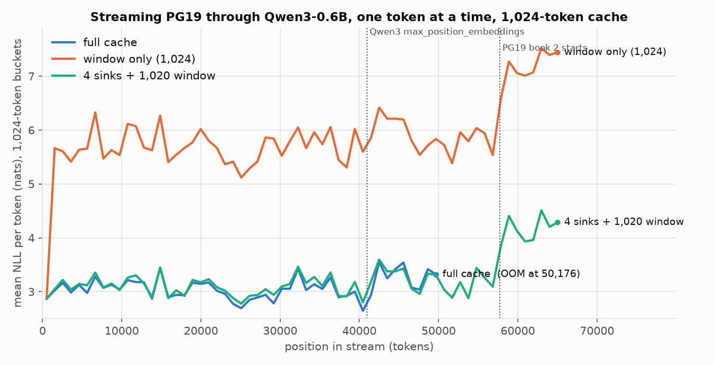
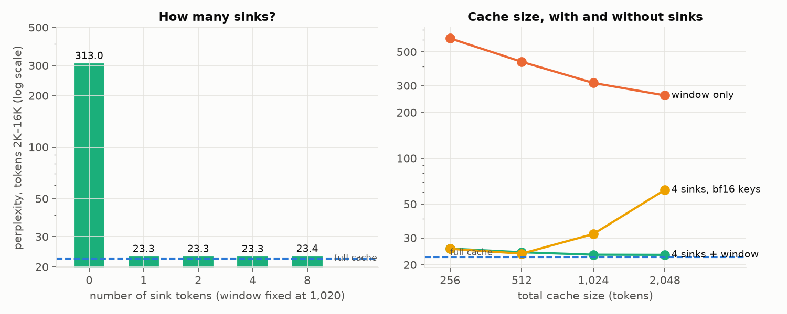
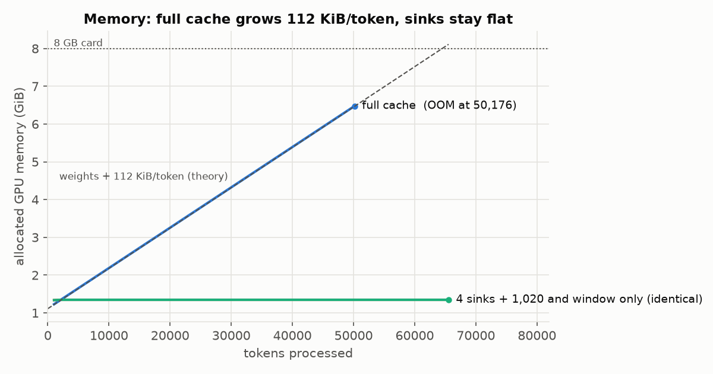
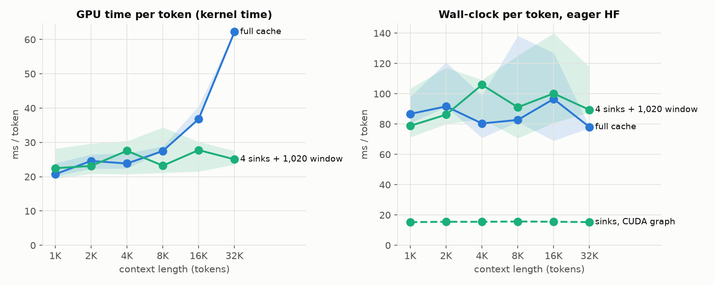
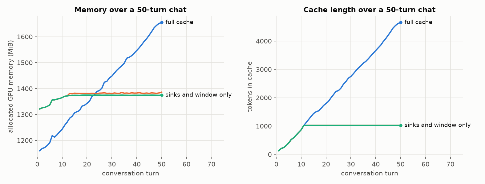

# Attention sinks for Transformers 5

A StreamingLLM KV cache written against the **Transformers 5 per-layer cache
API**. It keeps the first few "sink" tokens forever, keeps a rolling window of
recent tokens, and evicts everything in between. Positions are handled by
**re-rotating cached keys on eviction**. `SinkCache` was removed from core
Transformers, so this re-implements it as a `CacheLayerMixin` subclass that
plugs into any full-attention RoPE model without patching the model.

```python
from sinkcache import SinkCache

cache = SinkCache.from_model(model, n_sink=4, window=1020)
out = model(input_ids, past_key_values=cache, use_cache=True)   # stream forever
```

**Headline (Qwen3-0.6B, bf16, RTX 4060 Laptop 8 GB, PG19 streamed one token at a time):**
a 1,024-token sink cache keeps perplexity **within 5.3% of the full cache** over
the 50K tokens the full cache survives. The sink cache uses constant memory
(**1.38 GiB** total, against a full cache that grows **112 KiB/token** and runs out of memory at
**50,176 tokens**) and constant decode time (**15.3–15.7 ms/token** from 1K to 32K
tokens, while the full cache's GPU time triples). A window-only cache of the same size is
**14.4× worse** in perplexity than the full cache.



---

## Results

### Experiment 1: streaming perplexity

PG19 test books, concatenated in dataset order (book 1 ends at token 57,722).
Each token is fed through the cache one at a time, and the plot shows the mean NLL of the next
token per 1,024-token bucket. The three main configs all hold **1,024 tokens** of cache.

| range (tokens) | full cache | 4 sinks + 1,020 window | sinks vs full | window only (1,024) | window vs full |
|---|---:|---:|---:|---:|---:|
| 1,024–50,176 (all the full cache survived) | 21.77 | 22.92 | **+5.3%** | 313.0 | **14.4×** |
| 8,192–32,768 | 20.72 | 21.83 | +5.4% | 294.8 | 14.2× |
| 32,768–50,176 | 23.25 | 24.44 | +5.1% | 349.8 | 15.0× |

- The window-only cache is identical to the others until token 1,024. From the first
  eviction, perplexity jumps from ~20 to ~290 and stays there.
- The sink cache tracks the full cache bucket for bucket. The full cache itself
  degrades past 40,960 tokens, which is Qwen3's `max_position_embeddings`. The sink cache never
  goes past position 1,024, so position range never limits it.
- The step up at ~58K is the start of PG19 book 2, while the cache still holds book 1's last
  pages. The full cache had already run out of memory by then, so there is no baseline for that range.

**Ablations** (perplexity over tokens 2K–16K; the full cache scores 22.44 there):



| sinks (window 1,020) | ppl | | cache size | 4 sinks + window | window only |
|---:|---:|---|---:|---:|---:|
| 0 | 312.96 | | 256 | 25.55 | 613.16 |
| 1 | 23.34 | | 512 | 24.17 | 430.43 |
| 2 | 23.35 | | 1,024 | 23.29 | 312.69 |
| 4 | 23.29 | | 2,048 | 23.24 | 259.08 |
| 8 | 23.40 | | | | |

- **One sink token recovers all of the gap** (313 → 23.3). 2, 4 and 8 are the same to
  within noise. StreamingLLM found that 1 sink recovers most of the gap and 4 is enough; for Qwen3,
  1 is already enough.
- A 256-token sink cache (25.6) beats a 2,048-token window-only cache (259) by 10×.
  Cache size matters much less than keeping the sink.
- **Position handling matters:** without re-rotation the same cache scores **47,642**.

**Second model, Llama-3.2-1B** (16K tokens; `unsloth/Llama-3.2-1B`, the same weights as
the gated Meta repo; it uses `llama3` RoPE scaling, which `find_inv_freq` picks up):

| | 0–1K | 1K–2K | 2K–16K |
|---|---:|---:|---:|
| full cache | 9.23 | 9.48 | 9.73 |
| window only (1,024) | 9.23 | 132.60 | 177.28 |
| 4 sinks + 1,020 | 9.23 | 9.52 | **10.45 (+7.4%)** |

### Experiment 2: memory against length



| tokens | full cache | sinks / window (1,024) |
|---:|---:|---:|
| 1,024 | 1,258 MiB | 1,370 MiB |
| 16,384 | 2,938 MiB | 1,378 MiB |
| 32,768 | 4,730 MiB | 1,378 MiB |
| 49,152 | 6,522 MiB | 1,378 MiB |
| 50,176 | **OOM** | 1,378 MiB (to 65,536 and beyond) |

The full cache measures **112.00 KiB/token**, exactly the figure derived from the config
(see [bytes per token](#bytes-per-token)), and runs out of memory at 50,176 tokens on the 8 GB card.

The sink cache holds 1,025 slots × 28 layers of fp32 K and bf16 V, which is **168 MiB**
(see [precision](#the-precision-cost-of-re-rotation) for why the keys are fp32). With bf16
keys it would be 112 MiB. The rest of its 241 MiB above the weights is the CUDA-graph memory pool
and logits.

### Experiment 3: decode latency against length



Per-token decode at each context length. Three rounds, config order rotated each round,
medians reported. "GPU time" is the sum of CUDA kernel durations per token (CUPTI). The
breakdown is by kernel type:

| config | context | GPU ms/token | range | linear | attention | cache copies | other | sinks, CUDA graph |
|---|---:|---:|---:|---:|---:|---:|---:|---:|
| full cache | 1,024 | 20.8 | 20.1–23.9 | 10.4 | 1.7 | 3.1 | 5.5 | |
| full cache | 8,192 | 27.5 | 27.5–28.9 | 8.0 | 5.0 | 10.6 | 3.9 | |
| full cache | 16,384 | 36.8 | 36.8–40.6 | 7.0 | 10.2 | 15.8 | 3.9 | |
| full cache | 32,768 | **62.2** | 61.6–62.5 | 7.0 | 18.3 | **33.1** | 3.9 | |
| 4 sinks + 1,020 | 1,024 | 22.5 | 19.4–28.2 | 9.9 | 1.6 | 5.9 | 5.2 | **15.3 ms** |
| 4 sinks + 1,020 | 32,768 | 25.1 | 23.6–27.5 | 11.2 | 1.9 | 6.3 | 5.7 | **15.3 ms** |

**Does it match the memory-bound prediction?** Yes, once you count the bytes HF actually moves.
Decode reads every weight (1.19 GB) and the whole KV cache once per token. The brief's
estimate of "weights + KV" gives about 3–4× slower at 32K. But HF's `DynamicCache` appends with
`torch.cat`, which **reads and rewrites the entire cache every step**, so the per-token traffic
is **weights + 3 × KV**:

| at 32K tokens (KV = 3.76 GB) | bytes moved | measured | effective rate |
|---|---:|---:|---:|
| `torch.cat` cache copy (read + write) | 7.5 GB | 33.1 ms | 227 GB/s (copy ceiling) |
| attention reads K and V once | 3.76 GB | 18.3 ms | 205 GB/s |
| linear layers (weights) | 1.19 GB | 7.0 ms | 170 GB/s |

Predicted slope: 3 × 112 KiB ÷ 220 GB/s = **1.56 µs per extra token of context**.
Measured: (62.2 − 20.8) ms ÷ 31.7K tokens = **1.31 µs/token**. So at 32K the full cache costs
3× its short-context time, and **over half of it is the cache copy, not attention**. An
in-place cache, like the preallocated buffer used here for sinks, would remove that.

**Wall-clock caveats.** On this Windows laptop eager decoding is *launch-bound*:
~45 µs per kernel launch × ~500 launches is a 60–100 ms/token floor, which hides most of the KV
growth (right panel). The GPU also drops its clocks while waiting on the CPU (780 MHz SM
observed), which makes every kernel slower in eager mode and adds noise to the summed kernel
times. A sink cache has a property that sidesteps this: once full, every decode step has the same
shapes *and the same positions*, because the new token is always at position `n_sink + window`.
So the whole step can be captured in **one CUDA graph** and replayed, which gives **15.3–15.7 ms/token at
every length**. A growing `DynamicCache` can't be captured that way.

### Experiment 4: a long conversation, and what sinks don't fix

50 turns of Qwen3 chat (thinking off), streamed turn by turn. Turn 1 plants a fact:
*"my order ID is 4417"*. It is probed at turn 3, while the fact is still in the window, and at turn 50,
after it has been evicted from the sink and window caches. Each probe records the greedy answer and
the teacher-forced log-probability of "4417" after "Your order ID is ".



| config | tokens seen | turn 3 answer | log p | turn 50 answer | log p | memory, turn 1 → 50 | distinct-2 |
|---|---:|---|---:|---|---:|---|---:|
| full cache | 4,654 | `4417` | −0.00 | `4417` | **−0.01** | 1,160 → 1,655 MiB | 0.94 |
| 4 sinks + 1,020 | 5,668 | `4417` | −0.00 | `123456789` | **−13.7** | 1,321 → 1,375 MiB | 0.90 |
| window only | 2,035 | `4417` | −0.00 | *(empty)* | −29.9 | 1,321 → 1,386 MiB | 0.20 |

- **Sinks give stable fluency, not memory.** The sink cache keeps answering normally at
  flat memory, but once the fact is evicted it is gone: the model guesses a number, and "4417"
  is e^−13.7 ≈ 1-in-900,000. That is the expected behaviour, not a bug.
  Evicted content can only come back by re-retrieving it (RAG, summarisation, or a larger cache).
- The window-only cache degenerates. From about turn 20 every reply is an immediate end-of-turn
  token (distinct-2 of 0.20).

---

## Implementation

[`src/sinkcache/cache.py`](src/sinkcache/cache.py) contains `SinkLayer(CacheLayerMixin)` and
`SinkCache(Cache)`.

### Positions: the bug everyone makes

To the model, the kept tokens must look like a contiguous sequence 0…cache_len−1.
Transformers 5 derives positions from the cache:
`position_ids = cache.get_seq_length() + arange(q_len)`. So `SinkLayer.get_seq_length()`
returns the **in-cache** length, and new tokens land right after the kept ones. What remains is
to keep the kept keys consistent with that.

**(a) Re-rotate on eviction (this repo, and HF's removed `SinkCache`).** Keys are cached
*after* RoPE. RoPE rotates each pair of dimensions by `pos·θᵢ`, and rotations compose by adding
angles, so a key rotated at position p and then rotated by −Δ is *exactly* the key rotated at
p−Δ. When `drop` tokens are evicted from the front of the window, every surviving window key
moves `drop` positions earlier, so it is rotated by −drop. Sinks never move. Values carry no
position, so they are just shifted.

Qwen3 applies `k_norm`, a per-channel RMSNorm, *before* RoPE. So the cache holds
`rope(norm(k))`, and the identity still holds. That is tested, not assumed:
`test_qwen3_keys_shift` runs the real model with every position shifted by +3,000 and checks that the
re-rotated keys match the unshifted run at all 28 layers. `test_rotation_order_matters` shows the
identity would *fail* if the norm came after RoPE.

**(b) Cache keys before RoPE (StreamingLLM's approach).** Store un-rotated keys and apply RoPE
at attention time using in-cache positions 0…L−1. There is no re-rotation and no accumulated
rounding, and eviction is a pure slice. The costs:

- Every step rotates *all* cached keys, which is O(cache) extra work per token, though it fuses
  naturally into the attention kernel.
- It needs a change to the model's attention code, because HF applies RoPE before handing keys to
  the cache.

(a) works through the public cache API with no model patching.

### When eviction happens

`update()` runs *before* attention and must return the keys this step attends to. The current
queries were rotated at positions L…L+q−1, so they must see the old keys at their old positions.
Eviction therefore happens *after* attention: it is deferred to the start of the next `update`.
Between steps the logical cache is `n_sink + window` tokens; a decode step attends over
`n_sink + window + 1`. HF's own `DynamicSlidingWindowLayer` makes the same choice.

### The precision cost of re-rotation

This is the finding I didn't expect. Every window key is re-rotated **once per step** for its whole
life in the window, and in bf16 each re-rotation rounds the stored key again. The rounding error
random-walks, roughly √n × 2⁻⁹ after n steps:

- **In the unit tests:** 1.3% relative key error after 60 re-rotations in bf16, against
  9×10⁻⁷ in fp32.
- **In perplexity:** with bf16 key storage, a *bigger* sink cache got *worse*, the opposite of
  what it should do.

| cache size (4 sinks) | 256 | 512 | 1,024 | 2,048 |
|---|---:|---:|---:|---:|
| bf16 keys | 25.46 | 23.66 | **31.81** | **62.02** |
| fp32 keys (default) | 25.55 | 24.17 | 23.29 | 23.24 |

So `SinkCache` stores keys in **fp32** by default. Attention reads a bf16 copy; values stay
bf16. This costs +50% KV memory (168 MiB vs 112 MiB for 1,024 tokens). bf16 storage is still
available (`key_dtype=None`, the `_bf16k` configs).

A bf16 alternative without the drift: move the 4 sinks *forward* instead of moving the 1,020 window
keys *back*. Window keys keep their original rotation (exact, rounded once), and each step the sinks
are rotated directly from their stored originals to sit just before the window. RoPE only
sees relative distances, so attention is identical. The query then sits at the absolute stream
position, so positions grow without bound, and it needs `position_ids` fed from a device tensor to
stay CUDA-graph-friendly. I haven't built it.

### Making it fast on this machine

Three pieces exist because the obvious PyTorch path was slow here. Each is tested against a reference.

- **Preallocated in-place buffer.** K/V live in `n_sink + window + 1` slots updated in place,
  instead of a `torch.cat` of the whole cache every step.
- **Fused Triton eviction** ([`kernels.py`](src/sinkcache/kernels.py)). It shifts the window left
  and re-rotates keys in one pass: one read and one write per element, with fp32 math in registers.
  It works in place because each program walks rows from low to high with a barrier between a
  chunk's loads and its stores. The unfused PyTorch version moved about as many bytes per step as
  the model weights. Values come out bit-identical to the PyTorch path; keys agree to within one rounding.
- **Split-K flash-decoding attention backend** ([`decode_attention.py`](src/sinkcache/decode_attention.py)),
  registered as `attn_implementation="sdpa_decode"`. On the Windows PyTorch build no SDPA backend
  reads a growing GQA cache once:
  - Flash attention isn't compiled in.
  - Memory-efficient attention has no GQA support.
  - cuDNN re-plans for every new length, which took 0.5 s/token.
  - HF's default dispatch lands on the math backend, which upcasts to fp32 and takes 18.8 ms per layer at 32K.

  The kernel handles a whole GQA group per program, reaches 127 GB/s, and is used for *every*
  config. Its logits are as close to an fp32 reference as stock SDPA's (mean |Δ| 0.0605 vs 0.0609).

One trap worth knowing: on Windows the NVIDIA driver's *sysmem fallback* pages VRAM out to system
RAM when the card is full. A growing cache then never hits OOM; it slows ~10× and eats host RAM.
The experiments cap PyTorch's allocator at the free VRAM so that a real OOM is raised.

---

## Bytes per token

From the model config (`kv_bytes_per_token` in [`experiments/common.py`](experiments/common.py)):

| | layers | KV heads | head dim | K+V bytes per token (bf16) |
|---|---:|---:|---:|---:|
| Qwen3-0.6B | 28 | 8 | 128 | 28 × 2 × 8 × 128 × 2 = **114,688 B = 112 KiB** |
| Llama-3.2-1B | 16 | 8 | 64 | 16 × 2 × 8 × 64 × 2 = **32,768 B = 32 KiB** |

A 32K-token Qwen3-0.6B cache is 3.5 GiB, about 3× the model's 1.19 GB of weights. A 1,024-token
cache is 112 MiB whatever the stream length. Llama-3.2-1B has twice the weights but grows its cache
3.5× more slowly, because it has fewer layers and half the head dimension. GQA and head size, not
parameter count, decide how fast the KV cache grows.

## Why the first tokens become sinks

Softmax attention must sum to 1. A head with nothing useful to attend to still has to put its
probability mass *somewhere*. During training, the only tokens every query can see are the first
few (because of causal masking), so the model learns to use them as a dump: their keys draw large
attention scores whatever their content, and their values are close to neutral.

Evict them and that mass is redistributed over whatever is left in the window. That changes every
head's output at every layer, so the model is running on activations it never saw in training and
perplexity explodes (313 here). Keeping even **one** of them restores the distribution the model
expects (23.3). Their content doesn't matter, only that they exist and are visible to every query.

## Where it doesn't help

- **Memory of evicted content.** Sinks give stable fluency over unbounded streams, not
  long-term recall (Experiment 4). Anything outside the window is gone.
- **Quality versus a full cache.** Sinks are 5.3% worse in perplexity because the model only ever sees
  the last 1,020 tokens. It is a fixed-budget trade-off, not free context.
- **Prefill and chunked input.** A chunk longer than the cache gets full causal attention within
  itself, then gets trimmed. Within a chunk this is not streaming attention.
- **Batching, beam search, rollback.** `crop` and `reorder_cache` are not supported, and the CUDA
  graph path assumes batch-1 decode.
- **Speed at short context.** At 1K tokens the sink cache is no faster than a full cache: the eviction
  kernel, fp32→bf16 key copy and value shift cost ~6 ms of GPU time per step (the "cache copies"
  column). It only wins once the full cache is several thousand tokens long.

---

## Testing

`pytest` runs 63 tests in about 6 minutes:

- **Before any eviction**, logits are bitwise identical to `DynamicCache`.
- **Rotation**: rope(k, p) re-rotated by −Δ equals rope(k, p−Δ), at fp32 tolerance that scales
  with position. Our rotation matches HF's `apply_rotary_pos_emb` bit for bit. The Qwen3
  whole-network shift test and the norm-after-RoPE negative control are described
  [above](#positions-the-bug-everyone-makes).
- **After eviction (the strongest test)**: hooks record each layer's pre-RoPE keys and values
  during the sink run. The kept tokens' keys are then rotated **directly** at their new positions
  0…cap−1 by HF's own rotary code and put into a `DynamicCache`. The next-token logits from that
  cache must match the sink cache.
  - In fp32 they agree to 1×10⁻⁵ after 236 evictions; keys agree to 9×10⁻⁷ relative and values
    bit for bit.
  - Checked for 4 sinks and for window-only (0 sinks), through both the Triton and PyTorch paths.
  - A literal fresh forward pass over only the kept tokens can't match: those tokens' K/V were
    computed when they could still see tokens that were later evicted. This test isolates exactly
    what the cache claims, which is attention over the kept K/V at contiguous positions.
- **Teeth**: with re-rotation disabled, the same check fails by more than 1 logit.
- **Precision**: fp32 key storage cuts the accumulated drift from 1.3% to one bf16 rounding.
- **Kernels**: Triton eviction vs PyTorch (values bit-exact), flash-decode vs an fp32 reference across
  GQA shapes and lengths from 1 to 32K, and the registered backend in the real model.
- **CUDA graphs**: replay is bitwise identical to eager, including when multi-token chunks
  reallocate the buffers between graphed steps.

## Reproduce

```bash
uv venv --python 3.11 .venv
uv pip install torch --index-url https://download.pytorch.org/whl/cu128
uv pip install -e ".[dev]"          # transformers 5.22.1, triton / triton-windows

pytest                                # correctness, ~6 min
bash experiments/run_ppl.sh all       # Experiments 1-2 + ablations + Llama, ~4 h on a 4060 Laptop
python experiments/latency.py         # Experiment 3, ~20 min
python experiments/chat.py --config full          # Experiment 4, ~8 min per config
python experiments/chat.py --config sink4_w1020
python experiments/chat.py --config sink0_w1024
python experiments/plot.py            # plots + results/tables.md
```

Setup: RTX 4060 Laptop (8 GB, 256 GB/s), torch 2.11 + CUDA 12.8, transformers 5.22.1,
triton-windows 3.9, Windows 11, bf16 weights. Full tables: [`results/tables.md`](results/tables.md).

## Layout

```
src/sinkcache/
  cache.py              SinkLayer / SinkCache (eviction, re-rotation, in-place buffer)
  rope.py               RoPE helpers, reference re-rotation
  kernels.py            fused in-place shift + re-rotation (Triton)
  decode_attention.py   split-K flash-decode GQA attention backend (Triton)
  graphs.py             StreamRunner: CUDA-graph replay of steady-state decode
tests/                  pytest suite
experiments/            ppl.py, latency.py, chat.py, plot.py, run_ppl.sh
results/                CSVs, JSON, plots, tables.md
```
